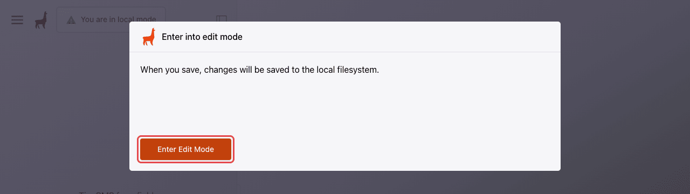
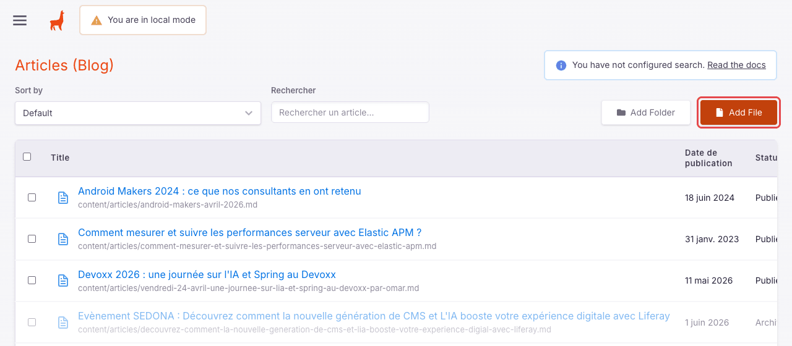
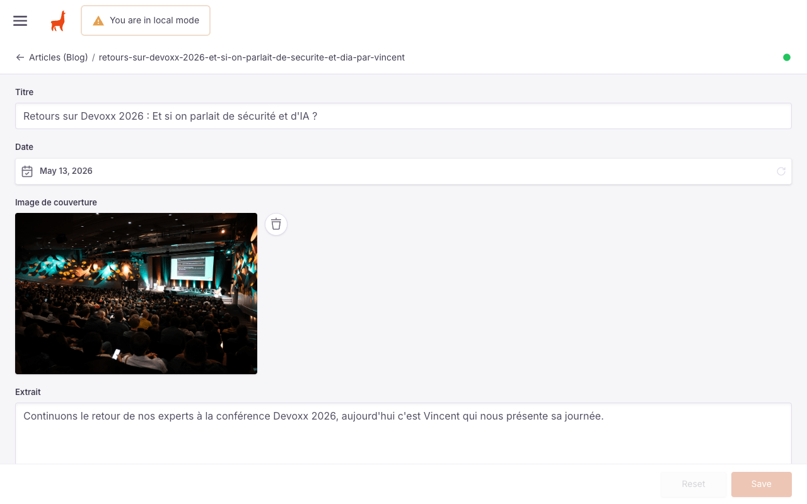
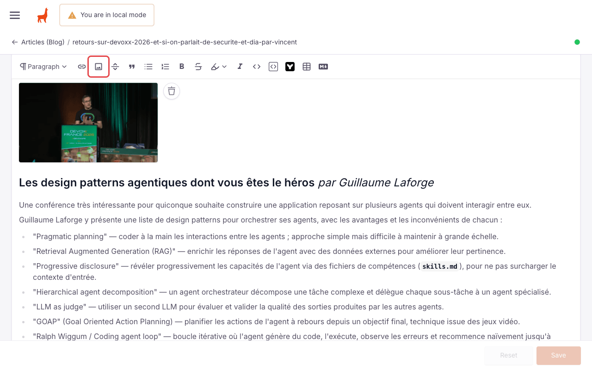
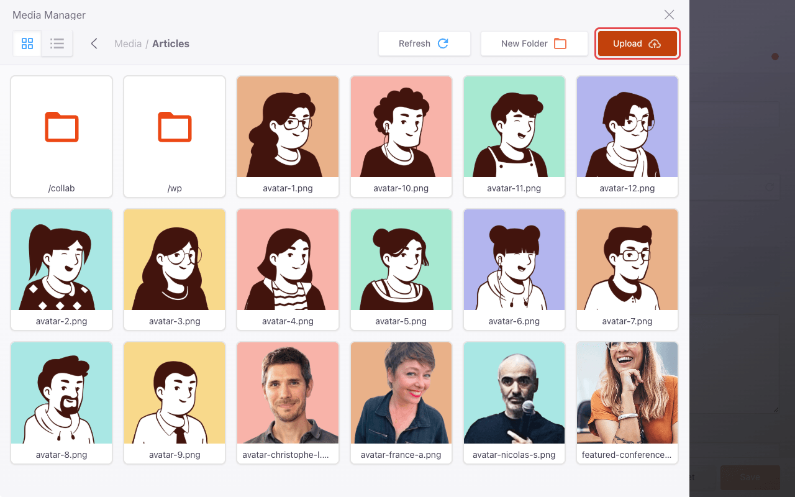
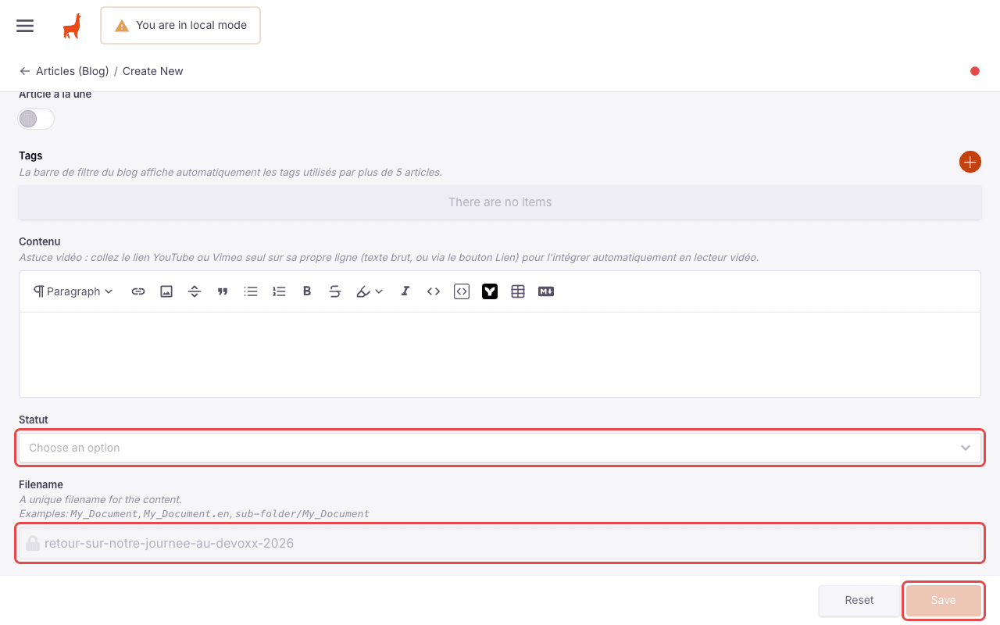
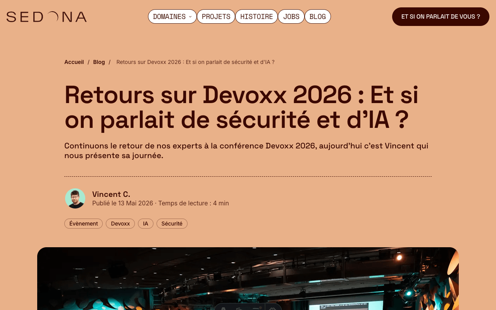
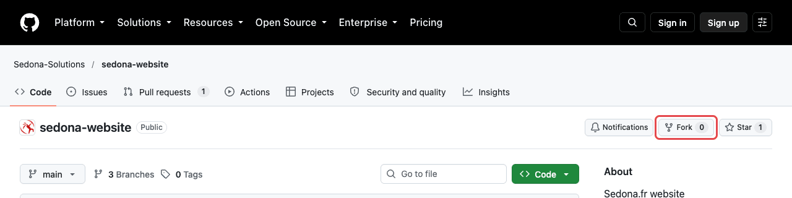

# Contribuer un article au blog

Ce guide explique comment proposer un article pour le blog du site Sedona depuis
votre poste : récupérer le projet, rédiger l'article dans TinaCMS, le
prévisualiser, puis le soumettre en pull request.

Aucune connaissance du code du site n'est nécessaire, il suffit d'être à l'aise
avec quelques commandes dans un terminal.

## Comment ça marche

- Chaque article est un fichier Markdown du dossier `content/articles/`, et ses
  images sont rangées dans `public/uploads/`.
- TinaCMS fournit une interface d'édition qui tourne sur votre machine et écrit
  directement dans ces fichiers.
- Vous proposez ensuite ces fichiers sur GitHub via une pull request (PR), qui
  est relue avant d'être acceptée.
- L'article est mis en ligne quand la PR est fusionnée dans `main` : le site est
  alors reconstruit et déployé automatiquement.

Les étapes :

1. Installer les prérequis (une seule fois)
2. Récupérer le projet (une seule fois)
3. Créer une branche pour l'article
4. Rédiger l'article dans TinaCMS
5. Prévisualiser
6. Envoyer l'article et ouvrir une pull request

## 1. Prérequis

| Outil | À quoi il sert | Installation |
|---|---|---|
| Compte GitHub | proposer la pull request | <https://github.com/signup> |
| Git | récupérer le projet et envoyer vos modifications | <https://git-scm.com/downloads> |
| Node.js 22.12 ou plus récent | faire tourner le site et TinaCMS | <https://nodejs.org> (version LTS) |
| GitHub CLI (recommandé) | connecter simplement Git à votre compte GitHub | <https://cli.github.com> |

Vérifiez les versions installées :

```bash
git --version
node --version   # doit afficher v22.12.0 ou plus
```

Si vous n'avez jamais utilisé Git sur ce poste, déclarez votre identité (elle
apparaîtra dans l'historique du projet) :

```bash
git config --global user.name "Prénom Nom"
git config --global user.email "prenom.nom@exemple.fr"
```

Connectez ensuite Git à votre compte GitHub, qui n'accepte plus les mots de
passe lors d'un envoi :

```bash
gh auth login
```

Choisissez `GitHub.com`, puis `HTTPS`, acceptez d'authentifier Git avec vos
identifiants GitHub et terminez la connexion dans le navigateur.

## 2. Récupérer le projet

À faire une seule fois :

```bash
git clone https://github.com/Sedona-Solutions/sedona-website.git
cd sedona-website
npm ci
```

`npm ci` télécharge les dépendances du site, ce qui prend quelques minutes la
première fois.

Tout le monde clone le dépôt Sedona, que vous ayez ou non les droits d'écriture
dessus : la différence n'intervient qu'au moment d'envoyer l'article
([étape 6](#6-envoyer-larticle)).

**Pour un article suivant**, repartez de la dernière version du site :

```bash
git switch main
git pull
npm ci
```

## 3. Créer une branche

Chaque article se prépare sur sa propre branche. Donnez-lui un nom court qui
évoque l'article :

```bash
git switch -c article/retour-devoxx-2026
```

## 4. Rédiger l'article dans TinaCMS

### Lancer TinaCMS

```bash
npm run dev:cms
```

Attendez que le terminal affiche l'adresse `http://localhost:4321/`, puis ouvrez
l'interface d'administration :

**<http://localhost:4321/admin/index.html>**

Laissez ce terminal ouvert pendant toute la rédaction. Pour arrêter TinaCMS,
tapez `Ctrl+C` dans ce terminal.

> `npm run dev` lance le site seul, sans l'interface d'administration : utilisez
> bien `npm run dev:cms`.

Au premier affichage, cliquez sur **Enter Edit Mode**. Le bandeau « You are in
local mode » est normal : vos modifications sont enregistrées dans les fichiers
de votre copie du projet, rien n'est envoyé en ligne.



### Créer l'article

Dans le menu de gauche (bouton à trois traits en haut à gauche s'il est replié),
choisissez **Articles (Blog)**, puis cliquez sur **Add File**.



Pour vous inspirer, ouvrez un article existant depuis cette liste. Voici à quoi
ressemble un formulaire rempli :



### Remplir les champs

| Champ | Où il apparaît | Conseil |
|---|---|---|
| Titre | en tête de l'article et sur sa carte dans les listes | il sert aussi à générer l'adresse de la page (voir [Enregistrer](#enregistrer)) |
| Date | « Publié le ... » ; les articles sont classés du plus récent au plus ancien | indiquez la date de publication souhaitée |
| Image de couverture | grande image en tête d'article et vignette des cartes | format paysage, voir [Ajouter des images](#ajouter-des-images) |
| Extrait | chapeau sous le titre, texte des cartes, description pour les moteurs de recherche | une ou deux phrases |
| Auteur | à côté de l'avatar | sous la forme « Prénom N. », par exemple « Vincent C. » |
| Avatar auteur | rond à côté du nom | voir [Ajouter des images](#ajouter-des-images) |
| Temps de lecture | à côté de la date | par exemple « 5 min de lecture » |
| Article à la une | met l'article en avant sur l'accueil et en tête du blog | laissez décoché, sauf demande de l'équipe |
| Tags | sous l'auteur ; servent à proposer des articles proches et au filtre du blog | reprenez l'orthographe des tags existants (« IA », « Évènement », ...) |
| Contenu | corps de l'article | voir ci-dessous |
| Statut | aucun affichage | voir [Enregistrer](#enregistrer) |

### Rédiger le contenu

L'éditeur du champ **Contenu** propose une barre d'outils classique : titres
(menu « Paragraph »), liens, images, citations, listes, gras, italique, code,
tableaux. Les habitués du Markdown peuvent basculer en mode source avec le
dernier bouton de la barre.



Pour intégrer une vidéo YouTube ou Vimeo, collez son lien seul sur sa propre
ligne : il est transformé automatiquement en lecteur vidéo.

### Ajouter des images

Un clic sur le champ **Image de couverture** ou **Avatar auteur**, ou sur le
bouton image de l'éditeur, ouvre la médiathèque :

1. ouvrez le dossier `/articles` ;
2. cliquez sur **Upload** et choisissez le fichier sur votre ordinateur ;
3. cliquez sur l'image, puis sur **Insert**.



Quelques règles :

- **Nom de fichier** : parlant, en minuscules, sans espace ni accent
  (`devoxx-2026-keynote.jpg` plutôt que `IMG_2034 copie.JPG`).
- **Poids** : photos en JPEG ou WebP, 1600 pixels de large au maximum. Les
  images sont conservées dans l'historique Git, inutile d'envoyer des fichiers
  de plusieurs mégaoctets.
- **Avatar** : votre photo existe peut-être déjà dans `/articles/collab`
  (fichiers nommés `prenom-n.png`). Sinon, déposez-y une photo carrée en JPEG
  d'environ 256 pixels de côté, ou choisissez un avatar illustré (`avatar-1.png` à `avatar-12.png` dans
  `/articles`).

### Enregistrer

En bas du formulaire :



- **Statut** : choisissez **Publié**. Rien n'est mis en ligne tant que la pull
  request n'est pas fusionnée, et ce statut est nécessaire pour prévisualiser
  l'article.
- **Filename** : généré automatiquement à partir du titre, il devient l'adresse
  de la page (`/blog/retour-sur-notre-journee-au-devoxx-2026`). Il est fixé au
  premier enregistrement : modifier le titre ensuite ne change plus l'adresse.
  Vérifiez donc votre titre avant d'enregistrer.
- Cliquez sur **Save**. TinaCMS crée le fichier `content/articles/<filename>.md`.
  Vous pouvez enregistrer aussi souvent que vous le souhaitez.

## 5. Prévisualiser

Ouvrez la page de l'article dans un autre onglet, en reprenant le nom de fichier
affiché à l'enregistrement :

`http://localhost:4321/blog/retour-sur-notre-journee-au-devoxx-2026`

La page reflète chaque enregistrement (rechargez-la au besoin). Vérifiez aussi
la carte de l'article sur <http://localhost:4321/blog>.



## 6. Envoyer l'article

Ouvrez un second terminal dans le dossier `sedona-website` (ou arrêtez TinaCMS
avec `Ctrl+C`).

### Vérifier les fichiers modifiés

```bash
git status
```

Seuls votre article et vos images doivent apparaître, par exemple :

```
content/articles/retour-sur-notre-journee-au-devoxx-2026.md
public/uploads/articles/devoxx-2026-keynote.jpg
```

Si d'autres fichiers sont listés (un autre article enregistré par erreur, un
fichier du dossier `tina/`, ...), annulez ces modifications avant de continuer :
`git restore <fichier>` pour un fichier existant, suppression pour un fichier
créé par erreur. Relancez ensuite `git status` pour vérifier.

### Enregistrer dans Git (commit)

```bash
git add .
git commit -m "Ajoute l'article sur notre journée au Devoxx 2026"
```

`git add .` prend tous les fichiers listés par `git status`, d'où l'importance
de la vérification précédente.

### Envoyer la branche sur GitHub (push)

**Si vous avez les droits d'écriture sur le dépôt Sedona-Solutions/sedona-website :**

```bash
git push -u origin article/retour-devoxx-2026
```

**Si vous n'avez pas ces droits**, ou si la commande précédente est refusée
(`Permission denied`, erreur 403), passez par une copie du dépôt sur votre
compte, appelée fork :

1. Sur <https://github.com/Sedona-Solutions/sedona-website>, cliquez sur
   **Fork**, puis sur **Create fork**.

   

2. Déclarez votre fork comme seconde destination, puis envoyez-y la branche, en
   remplaçant `<votre-compte>` par votre identifiant GitHub :

   ```bash
   git remote add fork https://github.com/<votre-compte>/sedona-website.git
   git push -u fork article/retour-devoxx-2026
   ```

   La commande `git remote add` ne se fait qu'une fois : pour les articles
   suivants, seul le `git push` est nécessaire.

### Ouvrir la pull request

Après le push, le terminal affiche un lien pour créer la pull request. Sinon,
ouvrez <https://github.com/Sedona-Solutions/sedona-website> : un bandeau
**Compare & pull request** propose votre branche.

Vérifiez que la PR va bien de votre branche vers la branche `main` du dépôt
`Sedona-Solutions/sedona-website`, reprenez le titre de l'article comme titre de
la PR, et précisez dans la description ce qui peut aider la relecture (date de
publication souhaitée, points à vérifier, ...). Cliquez enfin sur **Create pull
request**.

En cas de doute, la documentation GitHub détaille la
[création d'une pull request depuis un fork](https://docs.github.com/fr/pull-requests/collaborating-with-pull-requests/proposing-changes-to-your-work-with-pull-requests/creating-a-pull-request-from-a-fork).

### Après la relecture

Pour appliquer les corrections demandées, relancez `npm run dev:cms` si besoin,
modifiez l'article, enregistrez, vérifiez avec `git status` comme à la première
fois, puis :

```bash
git add .
git commit -m "Prend en compte la relecture"
git push
```

La pull request se met à jour automatiquement. Une fois fusionnée, le site est
reconstruit et l'article est en ligne quelques minutes plus tard.

## Statuts d'un article

| Statut | Effet |
|---|---|
| Publié | affiché sur le site, une fois la PR fusionnée |
| Brouillon | affiché nulle part, même en local ; utile pour fusionner un article pas encore prêt à paraître |
| Archivé | retiré du site, mais conservé et toujours modifiable dans TinaCMS |

Un article sans statut est considéré comme publié.

## En cas de problème

| Symptôme | Solution |
|---|---|
| `npm ci` ou `npm run dev:cms` signale une version de Node trop ancienne | installez la version indiquée dans les [prérequis](#1-prérequis), puis relancez `npm ci` |
| `/admin/index.html` affiche une erreur | vérifiez que vous avez lancé `npm run dev:cms` (et non `npm run dev`) et que le terminal affiche l'adresse du site |
| le terminal indique que le port 4001 est déjà utilisé | un autre `npm run dev:cms` tourne déjà dans un autre terminal : arrêtez-le |
| le site s'ouvre sur un autre port que 4321 | le port était occupé : utilisez l'adresse affichée dans le terminal |
| l'article n'apparaît pas dans l'aperçu | vérifiez son statut, et que l'adresse reprend exactement le nom du fichier dans `content/articles/` |
| `git push` demande un mot de passe ou échoue à l'authentification | lancez `gh auth login` (voir [Prérequis](#1-prérequis)) |
| `git push` est refusé (`Permission denied`, erreur 403) | vous n'avez pas les droits d'écriture : passez par un fork (voir [étape 6](#6-envoyer-larticle)) |
